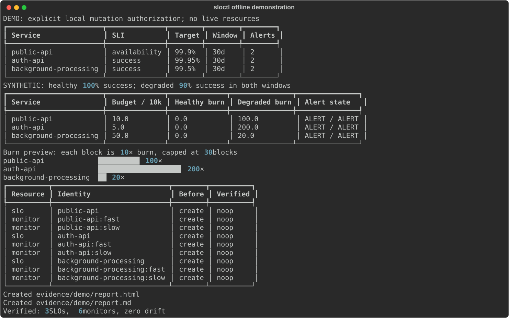
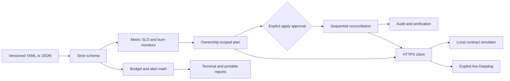

# SLO-as-Code Toolkit

[](https://github.com/jayekwere/slo-as-code-toolkit/actions/workflows/ci.yml)
[](pyproject.toml)
[](LICENSE)

Version-controlled metric SLOs, error budgets, multi-window burn alerts, and explicit Datadog reconciliation. The complete demo runs locally without credentials, paid accounts, Docker, or cloud resources.

**Safety defaults:** plan and drift only read API resources. Apply displays changes and asks for confirmation. Live writes require both `apply` and `--allow-live-mutations`. Ownership collisions fail closed. There is no deletion operation.



## Five-minute offline quickstart

Use Python 3.12 or newer:

```sh
git clone https://github.com/jayekwere/slo-as-code-toolkit.git
cd slo-as-code-toolkit
python3 -m venv .venv
. .venv/bin/activate
python -m pip install .
sloctl validate examples/public-api.yaml examples/auth-api.yaml examples/background-processing.yaml
sloctl plan examples/public-api.yaml
sloctl apply examples/public-api.yaml --yes
sloctl drift examples/public-api.yaml
sloctl simulate examples/public-api.yaml --good 9800 --total 10000
sloctl export examples/public-api.yaml --output reliability.html
sloctl demo
```

`--yes` explicitly approves the displayed local changes. Omit it for an interactive confirmation. The default backend is a persistent SQLite Datadog API simulator, not a live account. `demo` explicitly approves only its fresh local test resources, exercises all three fictional services, verifies zero drift, and writes JSON, Markdown, HTML, audit records, and a terminal SVG to `demo-output/`. Its output directory must be new.

For a locked development environment install `uv==0.13.6`, then run `uv sync --frozen --all-extras`. After dependencies are installed, the default workflow requires no network.

## Commands

| Command | Behavior | Relevant options |
| --- | --- | --- |
| `validate FILE...` | Strict YAML/JSON schema and alert validation | multiple definitions |
| `plan FILE...` | Full before/desired configuration and approval fingerprint | `--output plan.json` |
| `diff FILE...` | Proposed create/update/noop table | `--state`, `--live`, `--site` |
| `drift FILE...` | Inspect desired resource drift | same as diff |
| `apply FILE...` | Recheck, reconcile, audit, then verify | `--yes`, `--expected HASH`, `--audit` |
| `simulate FILE...` | Synthetic event budgets and two-window alert preview | `--good`, `--total`, `--short-good`, `--short-total`, `--incomplete` |
| `export FILE... --output PATH` | Portable report with SLO and monitor payloads | `--format html\|markdown\|json` |
| `demo` | Complete three-service offline demonstration | `--output-dir` |
| `serve` | Optional standalone simulator on `127.0.0.1` | `--state`, `--port` |

Run `sloctl COMMAND --help` for exact arguments. `plan`, `diff`, `drift`, and `apply` accept `--state PATH` (default `.sloctl.db`) or explicitly opt into live Datadog with `--live`. `apply --live` additionally requires `--allow-live-mutations`. No command implicitly chooses live mode from credentials.

Exit codes: **0** success, **1** unexpected runtime failure, **2** invalid input, local I/O failure, or declined confirmation, **3** drift found (`diff`/`drift`), **4** API/authentication/schema/transport failure, **5** ownership, concurrency, or stale-plan conflict. Shell interruption may return 130.

## What it supports

- Availability and request success SLOs based on good/total event counters.
- Latency SLOs using an instrumented counter of requests within a declared threshold. It does not infer percentile SLIs or generate histogram bucket queries.
- One 7-, 30-, or 90-day objective per versioned service definition.
- Decimal error-budget allowance, consumption, remaining events, no-data handling, and strict two-window burn alerts.
- Official Datadog v1 metric SLO and SLO-alert monitor payloads, regional endpoint allowlist, bounded reads/retries, and non-retried writes.
- Ownership tags, stable identity, exact before/desired plans, duplicate detection, local apply locks, pre-write state checks, and post-apply verification.
- A persistent local contract simulator with both in-process HTTP transport and an optional real loopback HTTP facade.

## Architecture



## Documentation and evidence

- [Configuration reference](docs/configuration.md) and [example definitions](examples/)
- [SLO mathematics and assumptions](docs/mathematics.md)
- [Datadog integration and read-only verification](docs/datadog.md)
- [Operations and partial-failure recovery](docs/operations.md)
- [Threat model](docs/threat-model.md), [security policy](SECURITY.md), and [contribution guide](CONTRIBUTING.md)
- [Verification evidence](docs/verification.md), [offline plan](evidence/demo/plan.json), [verified resources](evidence/demo/verified.json), and [HTML report](evidence/demo/report.html)
- [Release procedure](docs/releases.md)

## Boundaries

Offline contracts establish local behavior; they do not establish successful live Datadog integration. No live resources have been created for this project. Metric existence, good-event subset semantics, production alert usefulness, and regional account permissions require separate verification.

The toolkit only manages explicitly supplied service identities. Unrelated resources, removed definitions, and removed alert identities are retained. It never deletes resources. Datadog does not provide atomic compare-and-swap for these operations: remote writers can race between the preflight read and the write. Use one deployment writer and a shared external deployment lock for live operation. A multi-resource apply is not a transaction; recover by inspecting the audit, re-planning, and applying the remainder.
